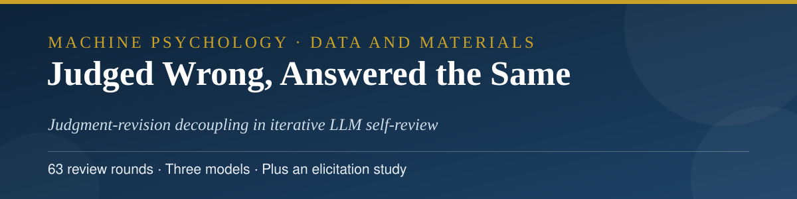
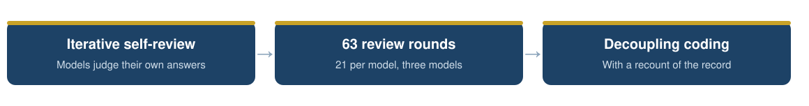
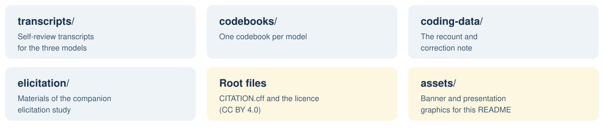

<p align="center">
  
</p>

<h3 align="center">Abbas Hamidavi</h3>

<p align="center">Department of Computer Engineering, Mashhad Branch, Islamic Azad University, Mashhad, Iran · ORCID: <a href="https://orcid.org/0009-0001-7342-7844">0009-0001-7342-7844</a></p>

<p align="center">
  <a href="mailto:abbashamidavi2002@gmail.com"></a>
  <a href="https://github.com/AVABBAS"></a>
  <a href="https://www.linkedin.com/in/abbas-hamidavi"></a>
  <a href="https://scholar.google.com/citations?user=FWqAHkgAAAAJ&hl=en"></a>
  <a href="https://www.researchgate.net/profile/Abbas-Hamidavi"></a>
  <a href="https://orcid.org/0009-0001-7342-7844"></a>
  <a href="https://avabbas.github.io/academic-cv/"></a>
</p>

<p align="center">
  
  
  
  <a href="LICENSE"></a>
</p>

<p align="center">
  
</p>

<p align="center">
  <a href="transcripts">Transcripts</a> · <a href="codebooks">Codebooks</a> · <a href="coding-data">Coding data</a> · <a href="elicitation">Elicitation</a>
</p>

# Judged Wrong, Answered the Same: Data and Materials

Data and materials for the article:

> Hamidavi, A. *Judged Wrong, Answered the Same: Judgment–Revision Decoupling in Iterative LLM Self-Review.* Submitted to *AI and Society*, November 2026. Preprint: Research Square, rs-10463884. The same materials are also deposited on the Open Science Framework: [osf.io/bef52](https://osf.io/bef52/).

<p align="center"></p>

## 📖 About the study

Three frontier models (GPT-5.4, Claude 4.6 Sonnet, and Gemini 3.1 Pro) solved one arithmetic word problem and then reviewed their own preceding output seven times in succession (63 review rounds in total), each time stating an explicit judgment of the work and a final answer. In 9 of the 63 rounds a model judged its own solution "partially wrong" and then restated the identical answer in the same response: the evaluative act was performed in full, and the number it condemned was repeated without change. A companion elicitation study is reported alongside: 36 further solutions to ten classic trap problems under two generation protocols, in which no model produced a wrong initial answer.

<p align="center">
  
</p>
## 🗂️ Contents

<p align="center">
  
</p>

| Folder | Contents |
| --- | --- |
| [`transcripts/`](transcripts) | The complete conversational transcripts for the three models (plain-text renderings of the archived PDFs in the OSF deposit). |
| [`codebooks/`](codebooks) | The three per-model codebooks (plain-text renderings of the archived PDFs). |
| [`coding-data/`](coding-data) | The archived inter-rater reliability report, and the recount and correction note described below. |
| [`elicitation/`](elicitation) | The complete elicitation-study materials: both pilot prompt sets, the per-model pilot solution logs, the reserve solutions, the compiled materials file, and the deposit's own readme. |

## 🔍 A note on the archived reliability report

> [!IMPORTANT]
> The archived inter-rater reliability report in `coding-data/` predates a full recount of the transcripts. Its headline agreement figures (100 percent agreement, kappa of 1.0) do not survive that recount and are explicitly disavowed in the article. The report is preserved here as part of the study record; the recount and correction note in the same folder gives the verified judgment and answer counts re-extracted mechanically from the transcripts, and those are the counts the article reports.

<p align="center"></p>

## 📚 Citation

Please cite the article. Citation metadata is provided in [CITATION.cff](CITATION.cff).

```bibtex
@article{hamidavi2026judged,
  author  = {Hamidavi, Abbas},
  title   = {Judged Wrong, Answered the Same: Judgment--Revision
             Decoupling in Iterative LLM Self-Review},
  journal = {AI and Society},
  year    = {2026},
  note    = {Manuscript submitted. Preprint: Research Square
             rs-10463884}
}
```

## 🔗 Access to the article

- **Preprint (Research Square, open access):** [researchsquare.com/article/rs-10463884](https://www.researchsquare.com/article/rs-10463884)
- **OSF deposit:** [osf.io/bef52](https://osf.io/bef52)
- **Journal:** submitted to *AI and Society*; the publisher link will be added here if the article is published.

## ⚖️ Licence

The contents of this repository are released under the Creative Commons Attribution 4.0 International licence (CC BY 4.0, see [LICENSE](LICENSE)).

The transcripts are outputs of publicly available AI systems, generated for this study. They contain no personal data.

<p align="center">
  
</p>
